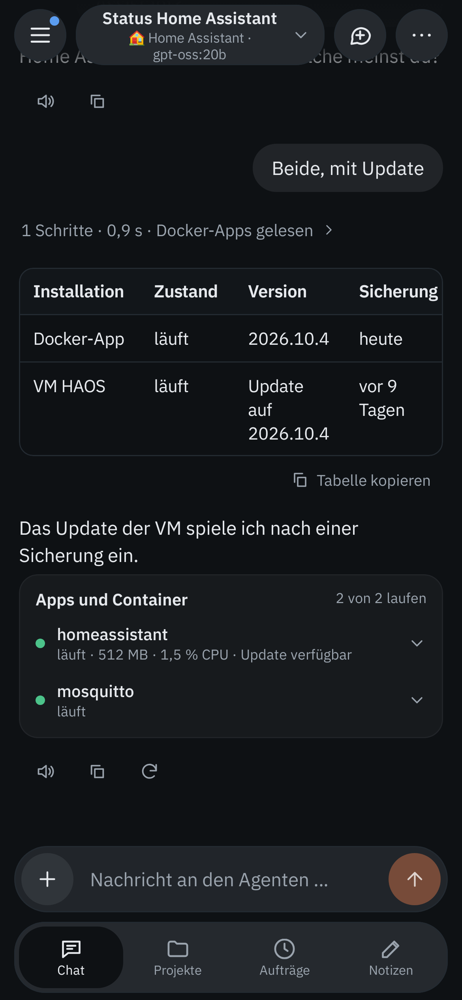
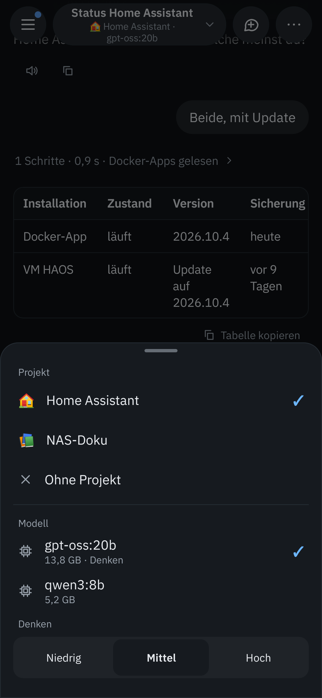
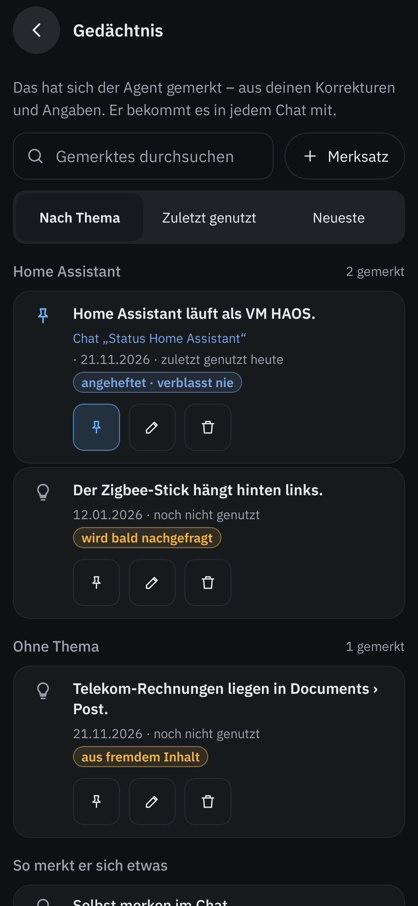
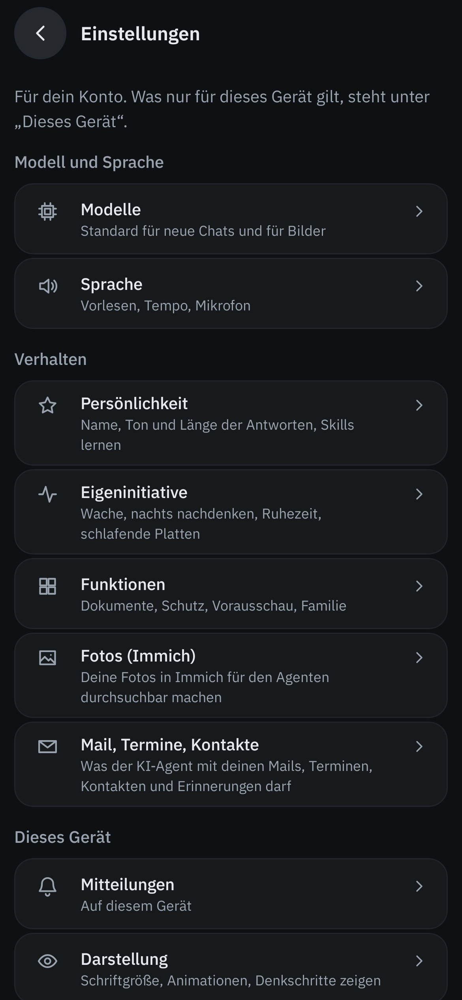
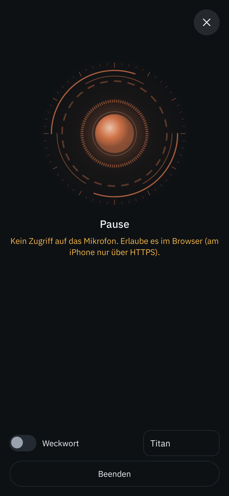
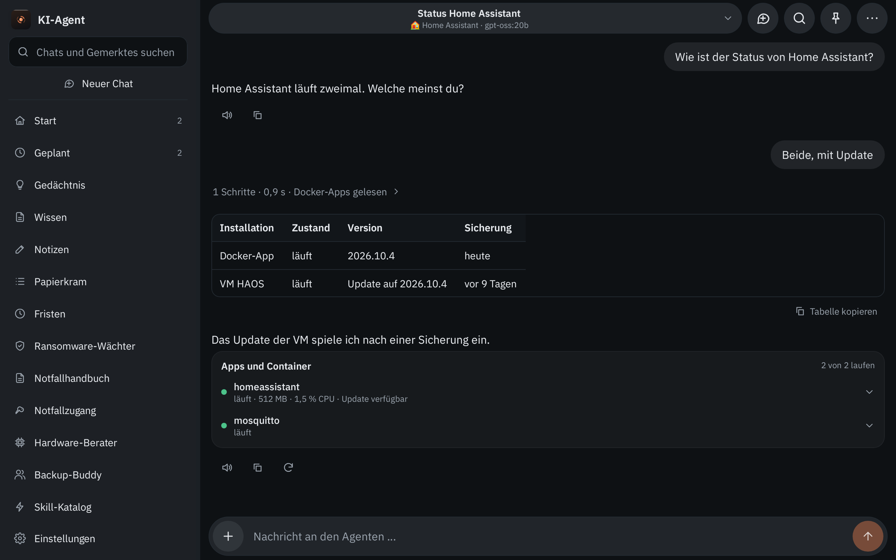

# TitanOS für Android

Die native Android-App zu [TitanOS](https://github.com/ra5on/TitanOS), dem NAS-Betriebssystem, das vom USB-Stick bootet und im RAM läuft. Sie bringt dein NAS aufs Handy, im selben Stil wie die Weboberfläche:

- Dateien
- Zustand des NAS
- Schritt für Schritt alles, was TitanOS im Browser kann: Foto-Sicherung im Hintergrund, Mail, Kalender und Kontakte in den Apps des Handys, Mitteilungen ohne Google, die ganze Systemsteuerung.

> **Status: Testfassung 0.03.** Frühes Grundgerüst zum Ausprobieren, noch keine fertige App. Was noch fehlt, zeigt sie mit „kommt in einer späteren Testfassung“.

<p>


</p>

## Was die Testfassung kann

- **Koppeln mit dem NAS.** Passwort und 2FA kommen dabei nie aufs Handy. Die App bekommt einen eigenen Schlüssel und hält das Zertifikat des NAS fest.
- **Start:** Zustand der Volumes, Laufzeit, Belegung und die Programme, die dein Konto sehen darf.
- **Dateien:**
  - Freigaben und Ordner durchsuchen
  - Teilen, In Downloads speichern, Umbenennen, In den Papierkorb
  - Hochladen über „+“
  - **Übertragungen im Hintergrund:** laufen weiter, wenn die App zu ist, und machen nach einem Abbruch beim Stand des NAS weiter; die Liste nennt den Grund, wenn etwas wartet, mit „Erneut versuchen“
  - **Offline verfügbar:** Dateien und ganze Ordner auf dem Handy behalten, abgeglichen alle 6 Stunden (ab Werk nur im WLAN, höchstens 5 GB), lesend zu öffnen auch ohne NAS
  - **Teilen-Menü:** „Teilen → Auf TitanOS speichern“ aus jeder App
- **Foto-Sicherung** (braucht **TitanOS 1.17**):
  - in eine frei wählbare Freigabe und einen Ordner, ab Werk mit Unterordnern je Jahr und Monat
  - Ordner am Handy wählbar, ab Werk die Kamera
  - wann, je Fotos und Videos: sofort, sofort im WLAN, im WLAN und beim Laden oder nur von Hand; mobile Daten auf Wunsch, im Ausland nie
  - Doppelte erkennt das NAS am Inhalt (SHA-256), auch nach Umbenennen
  - die App sagt immer, warum etwas wartet („wartet aufs Laden“, „das NAS ist nicht erreichbar“)
  - „Speicher freigeben“ löscht nur, was das NAS gerade per Prüfsumme bestätigt, älter als 30 Tage, nur auf Knopfdruck; Android fragt noch einmal, alles liegt 30 Tage im Papierkorb des Handys
- **Mitteilungen ohne Google** (braucht **TitanOS 1.18**):
  - dieselben Meldungen wie Web Push im Browser: NAS-Warnungen, neue Mail, Termine, KI-Agent, NVR
  - Liste mit Filtern Alle/NAS/Mail/Termine; ohne NAS der letzte Stand
  - „Direkt zum NAS“: eine eigene sparsame Verbindung (ab Werk an, mit der Bitte um die Akku-Ausnahme), sonst schaut die App alle 15 Minuten nach
  - je Art ein eigener Android-Kanal und ein Schalter „Was soll klingeln?“; „Ansehen“ und „Gelesen“ an jeder Mitteilung
- **Selbst-Update** unter **Menü › Über die App:**
  - sucht täglich auf GitHub nach einer neuen Version (abschaltbar), Testfassungen auf Wunsch
  - installiert erst nach deinem Tipp; Android fragt dabei womöglich noch einmal
  - installiert nur, was mit demselben Schlüssel signiert ist wie die App und zur Prüfsumme in `SHA256SUMS` passt
  - aktualisiert auch die Agent-App, wenn sie installiert ist
- **Widgets für den Startbildschirm:**
  - **NAS-Zustand:** Zustand in Worten, Belegung der größten Volumes, für Verwalter CPU und RAM; ohne NAS der letzte Stand mit „Nicht erreichbar“
  - **Fotos:** Stand der Foto-Sicherung, Tippen öffnet sie
  - **Agent fragen:** „Schreiben“ oder „Sprechen“ öffnet die Agent-App
  - aktualisiert alle 30 Minuten, solange ein Widget da ist
- **Systemsteuerung** (Programm „Systemsteuerung“ auf der Startseite) mit allem, was die Weboberfläche unter Einstellungen kann:
  - alle Seiten in denselben acht Bereichen wie im Web, Suche über jede einzelne Einstellung (Strg+K am großen Bildschirm)
  - am Handy Ebenen mit Pfeil zurück wie das Web am Handy, ab 761 dp Seitenleiste und Seite wie das Web am PC
  - Netzwerk mit Rückfall: die App zeigt den Countdown und bietet Bestätigen und Zurücknehmen an, auch wenn die Verbindung kurz weg ist
  - nur, was die Rolle des Kontos darf; das NAS prüft selbst
  - die Einstellungen der App (Fotos, Dateien, Mitteilungen, Kontakte und Kalender, Über die App) sind von dort verlinkt
- **Mein Konto:** Bild, Passwort, Zwei-Faktor-Anmeldung, Passkeys (Liste und Entfernen; anlegen geht nur im Browser, weil ein Passkey an die Adresse der Webseite gebunden ist), SSH-Schlüssel, WebDAV, Geräte und Android-Apps, angemeldete Geräte.
- **Fingerabdruck:** in einer Liste wählbar, welche Aktionen den Fingerabdruck (oder die PIN des Handys) verlangen, auch „beim Öffnen der App“. Ab Werk z. B. vor Updates, Ausschalten, Netzwerk und Löschen von Volumes. Konsolen fragen nie.
- **Darstellung** wie im Web je Konto (Thema, Akzent); je Gerät überschreibbar. Hell und dunkel folgen ab Werk dem Handy. Deutsch und Englisch.

## Installieren und koppeln

Nötig sind Android 13 oder neuer und ein NAS mit **TitanOS 1.16** oder neuer (Kopplung, Dateien). Für die Foto-Sicherung braucht es **TitanOS 1.17**, für die Mitteilungen **TitanOS 1.18**.

1. **APK laden** von der Seite [Releases](https://github.com/ra5on/TitanOS-Android/releases). Testfassungen gibt es vorerst direkt vom Projekt.
2. **Installieren:** Die APK auf dem Handy öffnen. Beim ersten Mal fragt Android, ob der Browser bzw. die Dateien-App „unbekannte Apps installieren“ darf. Erlauben, dann „Installieren“.
3. **Code anzeigen:** Im Browser in TitanOS **Mein Konto › Geräte › Android-Apps › „Android-App koppeln“** öffnen.
4. **In der App koppeln**, auf einem von drei Wegen:
   - **QR-Code scannen**, wenn TitanOS auf einem anderen Gerät offen ist.
   - **„Auf diesem Handy öffnen“**, wenn TitanOS im Browser desselben Handys offen ist.
   - **„Adresse von Hand eingeben“:** Die App zeigt den Fingerabdruck des Zertifikats in Vierergruppen. Im Browser unter „Ohne QR-Code“ steht derselbe Wert und ein Kopplungscode zum Abtippen.
5. **Bestätigen:** Der Browser fragt „<Name> möchte sich anmelden“. Mit deinem Kontopasswort bestätigen, dann macht die App von selbst weiter.

Zuhause verbindet sich die App direkt über das Heimnetz, unterwegs über Tailscale. Unter **Mein Konto › Geräte** siehst du jede gekoppelte App. Dort beendest du sie mit „Beenden“, dann ist sie sofort abgemeldet.

<p>


</p>

## Sicherheit

- **Die App ist eine Sitzung wie der Browser, kein API-Token.** Es gelten genau die Rechte deines Kontos.
- **Eigener Schlüssel je Handy:** ECDSA P-256, erzeugt im Android-Schlüsselspeicher, nicht auslesbar. Das NAS kennt nur den öffentlichen Teil. Mit dem Schlüssel unterschreibt die App eine Herausforderung, wenn sie eine neue Sitzung braucht, etwa nach einem Neustart des NAS.
- **Festgehaltenes Zertifikat (SPKI-Pinning):** Zeigt das NAS plötzlich ein anderes Zertifikat, fragt die App, statt still weiterzumachen. Namen mit öffentlichem Zertifikat (Let's Encrypt, `*.ts.net`) prüft sie zusätzlich ganz normal.
- **Ende:** Ein neues Kontopasswort, eine geänderte 2FA, „Beenden“ oder das Löschen des Kontos beenden die App.
- **Keine Google-Dienste:** kein Google Play Services, kein Firebase, kein ML Kit.

Einzelheiten zur Schnittstelle stehen in [`docs/ANDROID-APP.md`](https://github.com/ra5on/TitanOS/blob/main/docs/ANDROID-APP.md) im Repo TitanOS.

## Was als Nächstes kommt

In dieser Reihenfolge, jeweils als Testfassung:

1. ~~Dateien fertig~~ und ~~Foto-Sicherung~~ – in 0.02.
2. **Kontakte und Kalender** als Konto in den Apps des Handys, Abgleich in beide Richtungen; Mail.
3. **Zustand und Verwaltung:** Speicher, Docker, VMs, Systemcontainer, NVR, Sicherungen, Protokolle.
4. **Die ganze Systemsteuerung.** Sensible Einstellungen bestätigst du per Fingerabdruck.
5. ~~Agent-App, Widgets, Mitteilungen ohne Google, Selbst-Update~~ – in 0.03.

Danach folgt Version 1.00 mit allem.

## Agent-App

Die zweite App „Agent“ (`io.github.ra5on.titanos.agent`) bringt den KI-Agenten deines NAS aufs Handy, in der Gestaltung der Handy-Seite des Agenten im Web. Nötig ist **TitanOS 1.16** oder neuer mit eingeschaltetem KI-Agenten, der für dein Konto freigegeben ist.

<p>








</p>
<p>

</p>

- **Eigene Kopplung:** Die Agent-App koppelt sich selbst, mit eigenem Schlüssel im Keystore, und steht unter Mein Konto › Geräte als eigenes Gerät (App „agent“). Der Ablauf ist derselbe wie bei der TitanOS-App: QR-Code, „Auf diesem Handy öffnen“ oder Adresse von Hand.
  - **Kopplungslink mit beiden Apps:** Der Link `titanos://pair?…` nennt keine App. Sind beide Apps installiert, fragt Android bei „Auf diesem Handy öffnen“, welche App ihn öffnen soll. Gekoppelt wird die gewählte; für die andere erzeugst du im Browser einen neuen Code.
- **Aufbau wie die Handy-Seite des Agenten im Web** (Version 1.00): Texte und Symbole kommen aus der Weboberfläche (`feature-agent/tools/i18n.mjs`, `tools/icons.mjs`), Deutsch und Englisch.
  - **Startseite:** wechselnde Begrüßung, „N Dinge warten auf dich“, „Passt gerade“ mit „andere“, „Übersicht anzeigen“ mit Wartet auf dich (Freigaben, Vorschläge des Agenten), Läuft gerade, NAS-Zustand, Als Nächstes geplant, Zuletzt erledigt; „Neuer Chat“ nur mit der Frage und den Vorschlägen.
  - **Arbeitende Figur:** die drei Punkte Zahl für Zahl aus dem Web (Choreografie aus Ring, Acht, Schraube, Dreieck, Sammeln, Planeten), eine Uhr über jeden Wechsel, das Wort der Tätigkeit mit Lichtschweif, „Fertig“ mit Haken; Farbe und Größe aus der Darstellung, still bei „Animationen: Aus“ oder „Animationen entfernen“ von Android. Gezeichnet nur im Zeichenschritt, ohne Layout je Bild.
  - **Chat:** schwebender Kopf mit Titel, Projekt und Modell; Kopf-Blatt (Projekt, Modell mit Größe, Denkstufe); langer Druck oder Rechtsklick auf eine eigene Nachricht öffnet Bearbeiten und erneut senden, Kopieren, Antwort neu erzeugen, In diesem Chat suchen, Das merken; Zeile unter Antworten mit Vorlesen, Kopieren, Neu erzeugen; Schritte als Zeile mit Blatt und Rückgängig; Tabellen mit „Tabelle kopieren“; Karten für Container und Geräte, Fotos aus Immich; Plan, Freigaben, Rückfragen, erzeugte Dateien; Suche im Chat; „/“-Befehle; ⋯ mit Anheften, Umbenennen, Verschieben, Archivieren, Als Markdown/PDF speichern, Löschen; Plus-Blatt mit Foto, Datei, Dateien vom NAS, Sprechmodus und Arbeitsweise.
  - **Menü** von links (Wischen vom Rand): Suche über Chats und Gemerktes, Start, Geplant, Gedächtnis, Wissen, Notizen, Archiv, die eingeschalteten Funktionen, Projekte mit ihren Chats, Chats nach Tagen; Chats zur Seite wischen (wie eingestellt) oder lange drücken.
  - **Gedächtnis, Wissen, Geplant, Projekte, Notizen** mit allen Funktionen der Web-Seiten (Merksätze mit Thema, Anheften und Verblassen; Anweisungen, Skills, NAS-Landkarte, Suchorte, Protokoll; Morgenbericht, Aufträge und Erinnerungen mit allen Wiederholungen und Home-Assistant-Auslösern; Projekte mit Mitgliedern, Dateien und Gedächtnis; Notizen mit Ordnern, Anheften, Formatleiste).
  - **Einstellungen:** Modelle, Sprache, Persönlichkeit, Eigeninitiative, Funktionen (Dokumente, Schutz, Vorausschau, Familie mit ihren Ansichten), Fotos (Immich), Mail/Termine/Kontakte, Mitteilungen, Darstellung (Thema und Akzent wie das Konto oder je Gerät, Schrift bis 200 %, Figur), Gesten, Beim Öffnen, Alle Chats löschen, Über die App und Entkoppeln.
  - **Sprechmodus** mit der Figur des Webs, Ins-Wort-Fallen und Weckwort, über die Sprachdienste des NAS; Vorlesen über das NAS oder die Sprachausgabe des Handys; Spracheingabe über das NAS, sonst über die Erkennung des Handys.
  - **Große Bildschirme** (Tablet, Faltbares, Desktop-Modus): ab 761 dp Seitenleiste links (ziehbar) und Inhalt rechts wie im Web am PC; Enter sendet, Umschalt+Enter macht eine Zeile, Strg+N, Strg+F, Strg+K, Strg+„,“, Esc; Bilder und Dateien in den Chat ziehen.
  - **Digitaler Assistent:** in Android als Assistent wählbar; Ein-Taste lang drücken öffnet ein Blatt mit sofortiger Spracheingabe, die Antwort kommt mit der Figur darin. Bildschirminhalt nur nach Einstellung (Nie, Jedes Mal fragen – ab Werk –, Immer) und nur ans eigene NAS. Android muss dafür „Bildschirm- und App-Daten verwenden“ erlauben (die App weist darauf hin); im Emulator mit Android 17 lieferte das System trotz Schalter keinen Bildschirminhalt, mit Inhalt ist das noch nicht auf einem Gerät geprüft.
  - **Notizen-App des Systems** (Rolle Notizen ab Android 14): Stift-Taste und Sperrbildschirm öffnen eine neue Notiz.
  - **Funktionen** wie im Web und über dieselben Schnittstellen: Papierkram mit „zuordnen“ (Absender, Art, Datum), Fristen, Ransomware-Wächter, Notfallhandbuch als PDF oder Markdown speichern (über „Speichern unter“ von Android), Notfallzugang mit Code drucken (Druckdienst von Android), Hardware-Berater, Was-wäre-wenn mit „Durchspielen“, Backup-Buddy mit Kontingent und Freigaben je Partner, Skill-Katalog.
  - **Entwurf „Öffnen und bearbeiten“:** ein wartender Schritt für Mail, Termin, Kontakt oder Aufgabe öffnet sich als Entwurf im Editor; Office-Dateien des Agenten öffnen sich im Office-Editor der TitanOS-App, ohne sie in der Weboberfläche in der App (siehe unten).
  - **Uhrzeit und Datum** über die Wähler von Material 3 (24 Stunden nach der Einstellung von Android), im Wähler umschaltbar auf Eintippen; bei großer Schrift beginnt der Zeitwähler mit Eintippen.
  - **Barrierefreiheit:** jeder Bildschirm ist als Bildtest mit Schrift 200 % von Android dabei; die Bildtests melden abgeschnittene Texte, nicht gefüllte Platzhalter und Bedienelemente ohne Namen. Schalter sagen TalkBack, was sie schalten; Wörter werden getrennt statt mitten durchgebrochen.
  - **Android Auto:** Antworten, die kommen, während die App nicht vorne ist, erscheinen als Nachricht (MessagingStyle) mit „Antworten“ per Sprache und „Gelesen“. Ohne Play Store muss in den Entwickleroptionen von Android Auto „Unbekannte Quellen“ an sein. Nicht im Auto geprüft.
- **Ohne NAS:** Die Chatliste zeigt den letzten bekannten Stand. Senden scheitert sofort mit einer klaren Meldung, nichts kommt in eine Warteschlange.
- **Teilen → „Agent fragen“:** Text oder ein Bild aus einer anderen App landen in einem neuen Chat.

### Schnittstelle für andere Apps und Widgets

Die Agent-App öffnet einen neuen Chat und legt Text ins Eingabefeld:

```kotlin
context.startActivity(
    Intent("io.github.ra5on.titanos.agent.ASK")
        .setPackage("io.github.ra5on.titanos.agent")
        .putExtra("text", "Wie warm ist die Platte?") // optional, String
        .putExtra("voice", true)                       // optional, Boolean: gleich die Spracheingabe starten
        .addFlags(Intent.FLAG_ACTIVITY_NEW_TASK),
)
```

- Action `io.github.ra5on.titanos.agent.ASK`, Kategorie `DEFAULT`, die Activity ist exportiert.
- `text`: vorausgefüllter Text, höchstens 32 000 Zeichen.
- `voice`: `true` startet die Spracheingabe; das Erkannte kommt ins Feld.
- **Gesendet wird nie von selbst**, auch nicht mit `voice`: Jede App kann den Intent auslösen, deshalb schickt erst das Tippen auf Senden etwas ans NAS.
- „Teilen“ nutzt `ACTION_SEND` mit `text/*` oder `image/*`. Ein Bild wird sofort in den Speicher der App kopiert und mit der Nachricht als Anhang hochgeladen, höchstens 20 MB.

**Office in der TitanOS-App öffnen** (Entwurf „Öffnen und bearbeiten“, Dateien des Agenten): Die Agent-App ruft die TitanOS-App mit dieser Aktion auf. Die Namen stehen in `core-model` (`io.github.ra5on.titanos.model.OfficeIntent`), damit beide Seiten dieselben benutzen:

```kotlin
context.startActivity(
    Intent(OfficeIntent.ACTION)                       // "io.github.ra5on.titanos.OPEN_OFFICE"
        .setPackage(OfficeIntent.PACKAGE)             // "io.github.ra5on.titanos"
        .putExtra(OfficeIntent.EXTRA_PATH, "share/Documents/Brief.docx") // Datei: "<Ablage>/<Pfad>"
        // oder statt einer Datei eine Seite des Webs, etwa ein Entwurf des Agenten:
        // .putExtra(OfficeIntent.EXTRA_HREF, "/mail/compose?agentDraft=<chat>%3A<eintrag>")
        .addFlags(Intent.FLAG_ACTIVITY_NEW_TASK),
)
```

- `path`: Ablage und Pfad wie in der Dateiliste des Webs (`root=share`, `path=Documents/Brief.docx` → `share/Documents/Brief.docx`); die TitanOS-App öffnet die Datei in ihrem Office-Editor.
- `href`: eine Seite der Weboberfläche (Entwürfe für Mail, Termine, Kontakte, Aufgaben wie `draftHref` im Web).
- Ob die TitanOS-App die Aktion kann, prüft die Agent-App vorher (`queryIntentActivities`). Kann sie es nicht oder ist sie nicht installiert, öffnet die Agent-App dieselbe Seite des Webs in einer WebView mit ihrer eigenen Sitzung; fremde Zertifikate gelten dort nur, wenn sie das bei der Kopplung festgehaltene sind. Für eine Datei ist das der Ordner in den Dateien des Webs, weil das Web keine eigene Adresse für den Editor einer Datei hat.
- Die Seite der TitanOS-App fehlt noch: bis sie die Aktion annimmt, nimmt die Agent-App immer die WebView.

## Uhr (Wear OS)

Die Uhr-App „TitanOS“ (`io.github.ra5on.titanos.watch`, Datei `TitanOS-Watch-X.YY.apk`) läuft auf Uhren mit **Wear OS 4** oder neuer und braucht ein NAS mit **TitanOS 1.19**. Sie kommt **ohne Google** aus: keine Play-Dienste, keine Datenverbindung über die Wear-OS-App des Handys. Die Uhr spricht selbst mit dem NAS, über WLAN, über das Handy (Bluetooth) oder über LTE. Mitteilungen des Handys spiegelt Android ohnehin auf die Uhr.

- **Installieren:** Ohne Play Store kommt die APK per ADB auf die Uhr (Entwickleroptionen › ADB-Debugging bzw. Debugging über WLAN): `adb -s <uhr> install TitanOS-Watch-X.YY.apk`. Danach aktualisiert sie sich selbst unter Einstellungen › Update, geprüft wie bei den Handy-Apps (Prüfsumme aus `SHA256SUMS`, derselbe Signaturschlüssel).
- **Koppeln, angestoßen vom Handy:**
  1. In der TitanOS-App am Handy **Menü › Uhr koppeln** öffnen. Dort stehen die Adressen des NAS.
  2. Auf der Uhr **Adresse eingeben** und eine davon eintippen oder sprechen.
  3. Die Uhr zeigt **sechs Ziffern**. Diese am Handy eingeben und „Uhr koppeln“ tippen.
  - Die Ziffern hängen am Schlüssel der Uhr und am Zertifikat, das die Uhr sieht. Sitzt jemand dazwischen, passen sie nicht. Die Uhr ist danach ein **eigenes Gerät** unter Mein Konto › Geräte und lässt sich dort einzeln beenden.
- **Was die Uhr kann:**
  - Zustand des NAS, Speicher und neue Meldungen als **Kachel** und als **Komplikation** fürs Zifferblatt.
  - **Agent per Sprache:** Diktat über die Spracheingabe der Uhr. Ohne sie nimmt die Uhr selbst auf, und Whisper am NAS schreibt mit. Die Antwort kommt als Text, auf Wunsch vorgelesen (Stimme der Uhr oder Piper am NAS). **Freigaben** des Agenten erlauben oder ablehnen.
  - **Schalten** nach den Rechten des Kontos: Geräte von Home Assistant, Container und VMs starten und stoppen. Stoppen fragt vorher nach.
  - **Kameras:** Standbild und letzte Ereignisse des NVR.
- **Akku:** keine Dauerverbindung. Die Uhr fragt nur, solange eine Seite sichtbar ist, und wenn Android Kachel oder Komplikation neu zeichnet (höchstens alle 15 bzw. 30 Minuten).

## Bauen

Nötig sind JDK 21 und das Android-SDK mit `platforms;android-37.0` und `build-tools;37.0.0`.

```bash
export JAVA_HOME=/pfad/zu/jdk-21
export ANDROID_HOME=/pfad/zu/android-sdk
./gradlew assembleDebug testDebugUnitTest lint
```

Die Debug-APKs liegen danach unter `app-titanos/build/outputs/apk/debug/`, `app-agent/build/outputs/apk/debug/` und `app-watch/build/outputs/apk/debug/`.

- **Bildtests:** `./gradlew recordRoborazziDebug` schreibt alle Bildschirme in 412 dp Breite, hell und dunkel, nach `app-titanos/build/outputs/roborazzi/`. Die Agent-App (`AgentScreenshotTest`) zeigt jeden Bildschirm in 390 dp wie die Aufnahmen des Webs, hell und dunkel, dazu die Figur als Bildserie, 1280 dp breit und Schrift 200 %; die App spricht dabei mit einem MockWebServer mit den Testdaten des Webs. Bilder nach `feature-agent/build/outputs/roborazzi/`. Die Uhr (`WatchScreenshotTest`) zeigt jeden Bildschirm rund (227 dp) und eckig (198 dp), mit normaler und doppelter Schrift, und meldet abgeschnittene oder getrennte Wörter und namenlose Bedienelemente; Bilder nach `app-watch/build/outputs/roborazzi/`.
- **Release:** Ein Tag `vX.Y.0` startet `.github/workflows/release.yml`.
  - **Version:** angezeigt X.YY, `versionCode` X·100+Y. Der Workflow prüft, dass `build.gradle.kts` dazu passt.
  - **Signieren:** nur im Job „publish“ der Umgebung `release`. Die Umgebung lässt nur Tags `v*` zu und wartet auf die Freigabe des Inhabers. Der Schlüssel liegt dort als Secret.
  - **Prüfung vor dem Veröffentlichen:** Die APK muss das Zertifikat mit dem SHA-256 `636b5723…725c` tragen, sonst bricht der Lauf ab. Danach kommen APK und `SHA256SUMS` als Release auf GitHub, vor 1.00 als Vorab-Release.
  - **Versionshinweise** stehen in `docs/releases/vX.Y.0.md`.
  - **Lokal** signiert man über die Umgebungsvariablen `TITANOS_KEYSTORE` (Pfad zum Keystore) und `TITANOS_KEYSTORE_PASSWORD`, Alias `titanos-release`. Ohne sie bleibt `assembleRelease` unsigniert.
- **Stil:** Farben, Maße, Programmsymbole und die Schrift (IBM Plex) erzeugt `web/scripts/android-theme.mjs` im Repo TitanOS aus der Weboberfläche. Das Ergebnis unter `core-ui/…/ui/generated/` und `core-ui/src/main/res/font/` ist eingecheckt; geändert wird im Repo TitanOS, nicht hier.
  ```bash
  node web/scripts/android-theme.mjs ../TitanOS-Android
  ```
- **Kein abgeschnittener Text:** Eine eigene Lint-Regel verbietet `TextOverflow.Ellipsis` und `maxLines` bei Text.

## Aufbau

| Modul | Inhalt |
|---|---|
| `:core-model` | Datentypen der API |
| `:core-net` | OkHttp, Zertifikatsprüfung mit SPKI-Pinning, Geräteschlüssel im Keystore, Kopplung, Sitzung |
| `:core-ui` | TitanOS-Theme mit der Darstellung des Kontos, Bausteine im Zeilenaufbau, Fingerabdruck (`Guard`), Texte des Webs (`Tr`), Symbole, Schrift |
| `:feature-pairing` | Willkommen, QR-Code, Adresse von Hand, Koppeln bestätigen, Berechtigungen |
| `:feature-home` | Start mit Zustandskarte und Programmen |
| `:feature-files` | Freigaben, Ordner, Datei-Aktionen, Übertragungen |
| `:feature-notify` | Mitteilungen ohne Google: Liste, Kanäle, eigene Verbindung zum NAS |
| `:feature-update` | Über die App, Selbst-Update von GitHub mit Signatur- und Prüfsummenprüfung |
| `:feature-widgets` | Widgets NAS-Zustand, Fotos, Agent fragen (Glance) |
| `:feature-settings` | Systemsteuerung: alle Einstellungsseiten des Webs, Suche, Fingerabdruck-Liste, Darstellung des Geräts; Texte und Suchindex aus dem Web (`feature-settings/tools/web.mjs`) |
| `:feature-account` | Mein Konto |
| `:app-titanos` | die App „TitanOS“ (`io.github.ra5on.titanos`) |
| `:feature-agent` | Chat mit dem KI-Agenten: Strom (SSE), Freigaben, Markdown, Projekte, Aufträge, Notizen |
| `:app-agent` | die App „Agent“ (`io.github.ra5on.titanos.agent`) |
| `:app-watch` | die Uhr-App (`io.github.ra5on.titanos.watch`, Wear OS): eigene Kopplung, Kachel, Komplikation, Agent, Schalten, Kameras |
| `:lint-rules` | Lint-Regel gegen abgeschnittenen Text |

## Lizenz

Die App ist **Fair Source** unter der [Functional Source License 1.1 mit Apache-2.0-Zukunftslizenz (FSL-1.1-ALv2)](LICENSE.md), wie TitanOS. Nutzen, Ändern und Weitergeben ist erlaubt, nur kein konkurrierendes kommerzielles Angebot. Zwei Jahre nach Erscheinen steht jede Version unter der Apache License 2.0; bis dahin ist sie nicht „Open Source“.

Fremde Bestandteile behalten ihre Lizenz, siehe [THIRD_PARTY_LICENSES](THIRD_PARTY_LICENSES). Beiträge nur mit dem [CLA](CLA.md), siehe [CONTRIBUTING.md](CONTRIBUTING.md).
