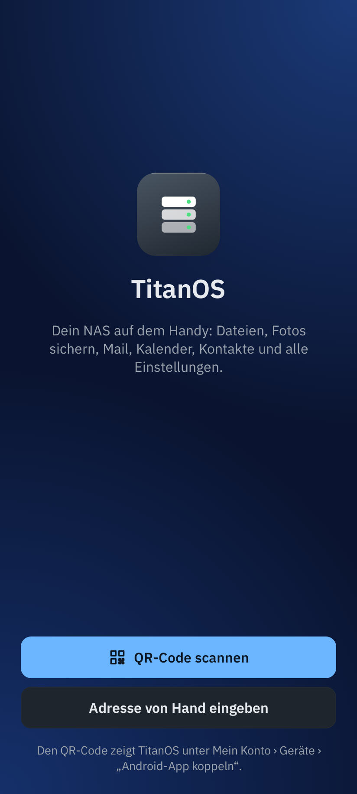
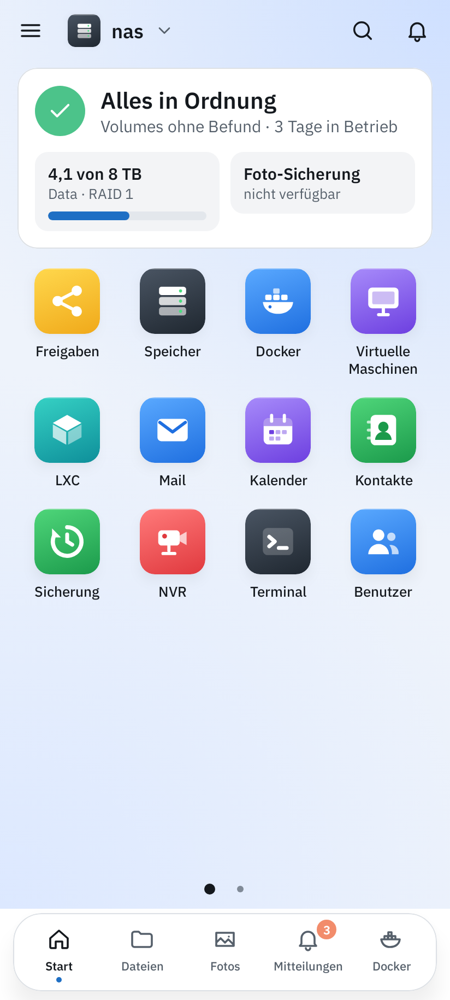
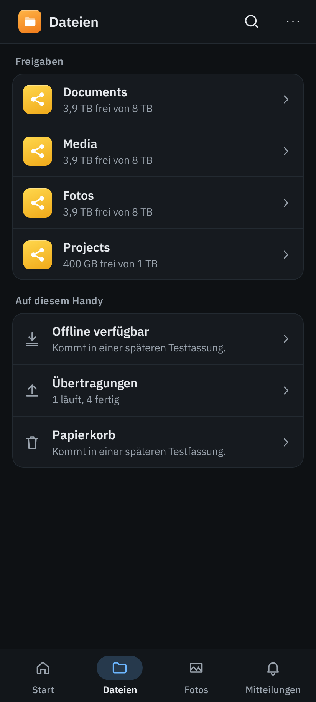
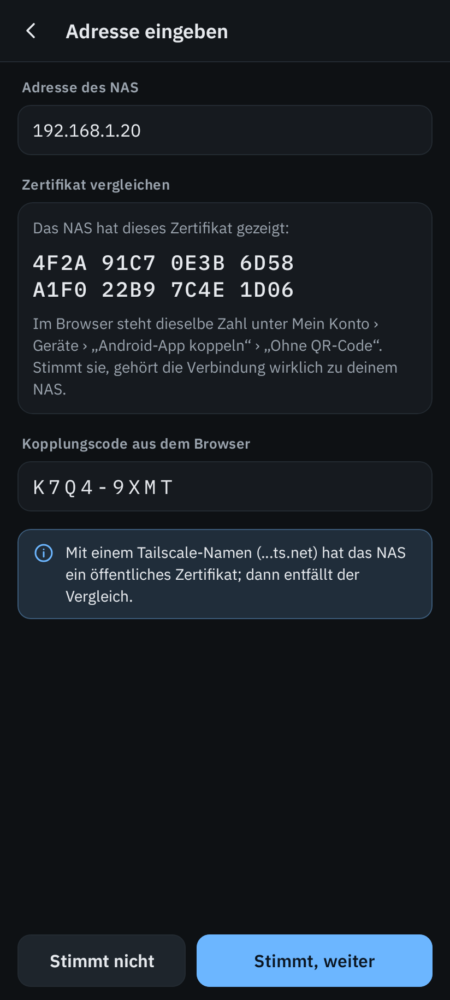
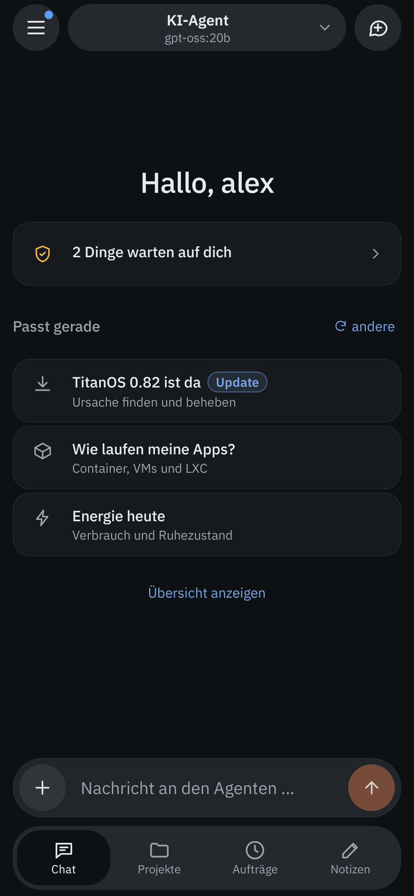
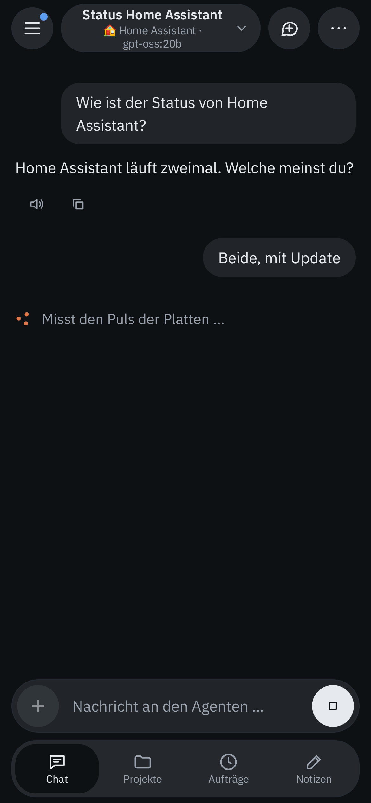
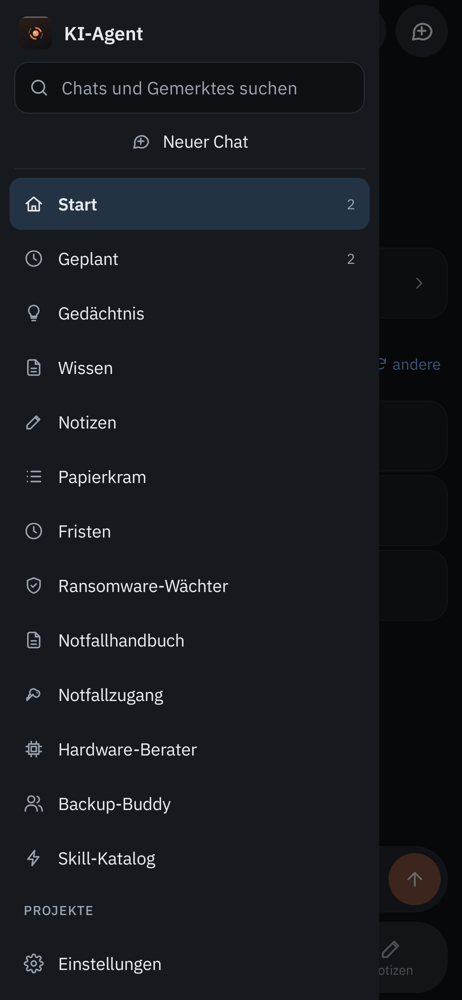

# TitanOS für Android

Die nativen Android-Apps zu [TitanOS](https://github.com/ra5on/TitanOS), dem NAS-Betriebssystem, das vom USB-Stick bootet und im RAM läuft. Alles, was TitanOS im Browser kann, geht auch in der App, im selben Stil wie die Weboberfläche und mit dem, was nur eine App kann: Foto-Sicherung im Hintergrund, Kontakte und Kalender in den Apps des Handys, Mitteilungen ohne Google, eigenes VPN, Widgets.

**Version 1.03.** Sie braucht ein NAS mit **TitanOS 1.19**.

<p>




</p>

## Zwei Apps

| App | Datei | Wofür |
|---|---|---|
| **TitanOS** (`io.github.ra5on.titanos`) | `TitanOS-Android-X.YY.apk` | das NAS am Handy, Tablet oder Monitor: Dateien, Fotos, Office, Mail, Kalender, Kontakte, Verwaltung, Docker, VMs, NVR, Terminal, Systemsteuerung, Mein Konto, VPN |
| **Uhr** (`io.github.ra5on.titanos.watch`) | `TitanOS-Watch-X.YY.apk` | Zustand, Agent per Sprache, Schalten und Kameras auf einer Wear-OS-Uhr |

Den KI-Agenten gibt es in der TitanOS-App: als Programm, am Arbeitsplatz und als Panel in Mail, Kalender und Kontakte, dazu Teilen → „Agent fragen“, Widget, Assistent, Notizen-App und Android Auto. Beide Apps sind mit demselben Schlüssel signiert.

**Die Agent-App (`io.github.ra5on.titanos.agent`) wird nicht mehr weiterentwickelt.** Ihre letzte Fassung `TitanOS-Agent-1.00.apk` liegt im Release 1.00; ab 1.01 kann alles, was sie konnte, die TitanOS-App. Wer sie noch hat, kann sie deinstallieren (**Seitenmenü › Über die App** öffnet ihre App-Info).

## Was du brauchst

- **Handy oder Tablet** mit Android 13 oder neuer. Für die Uhr Wear OS 4 oder neuer.
- **NAS mit TitanOS 1.19.** Auf einem älteren NAS gehen Koppeln, Dateien (ab 1.16), Foto-Sicherung (ab 1.17) und Mitteilungen (ab 1.18). Was 1.19 braucht, sagt die App: eine Kopplung für beide Apps, Kontakte und Kalender im Handy, das eigene VPN, die Uhr, die eigene Einrichtung des Arbeitsplatzes und des Startbildschirms am NAS.
- **Erreichbarkeit:** zu Hause über das Heimnetz, unterwegs über das eigene VPN der App, über Tailscale oder eine Adresse mit öffentlichem Zertifikat.
- **Keine Google-Dienste:** kein Google Play Services, kein Firebase, kein ML Kit.

## Installieren von GitHub

1. **APK laden** von der Seite [Releases](https://github.com/ra5on/TitanOS-Android/releases). Wer prüfen will: `sha256sum -c SHA256SUMS`.
2. **Installieren:** Die APK auf dem Handy öffnen. Beim ersten Mal fragt Android, ob der Browser bzw. die Dateien-App „unbekannte Apps installieren“ darf. Erlauben, dann „Installieren“.
3. **Updates** holt die App danach selbst: Sie sieht beim Öffnen höchstens alle sechs Stunden kurz auf GitHub nach (höchstens 10 Sekunden, bei schlechtem Netz gibt sie still auf) und dazu täglich im Hintergrund (abschaltbar unter **Seitenmenü › Über die App**). Ist eine neue Version da, zeigt die Startseite einen Hinweis mit „Jetzt aktualisieren“ und das Seitenmenü einen Punkt an „Über die App“. Installiert wird erst nach deinem Tipp und nur, was mit demselben Schlüssel signiert ist und zur Prüfsumme passt.

Eine Fassung für Google Play ist vorbereitet, aber nicht veröffentlicht.

## Koppeln

1. **Code anzeigen:** Im Browser in TitanOS **Mein Konto › Geräte › Android-Apps › „Android-App koppeln“** öffnen.
2. **In der App koppeln**, auf einem von drei Wegen:
   - **QR-Code scannen**, wenn TitanOS auf einem anderen Gerät offen ist.
   - **„Auf diesem Handy öffnen“**, wenn TitanOS im Browser desselben Handys offen ist.
   - **„Adresse von Hand eingeben“:** Die App zeigt den Fingerabdruck des Zertifikats in Vierergruppen. Im Browser unter „Ohne QR-Code“ steht derselbe Wert und ein Kopplungscode zum Abtippen.
3. **Bestätigen:** Der Browser fragt „<Name> möchte sich anmelden“. Mit deinem Kontopasswort bestätigen, dann macht die App von selbst weiter.
4. **Berechtigungen:** Danach fragt die App nach Fotos, Kontakten, Kalender, Mitteilungen und „Geräte im Heimnetz finden“. Alles lässt sich später ändern.

**Mehrere NAS oder Konten:** **Seitenmenü › NAS hinzufügen**, derselbe Ablauf mit eigenem Schlüssel. Umgeschaltet wird über den Knopf mit dem Namen des NAS oben auf der Startseite („titan“, mit gewähltem Knoten „titan · nas-keller“) oder im Seitenmenü; dort stehen auch die Knoten eines Clusters. Namen, Mitteilungen und Foto-Sicherung je NAS: **Seitenmenü › App-Einstellungen › NAS und Konten**. Mitteilungen, Foto-Sicherung (auch an mehrere NAS gleichzeitig), Widgets und Kontakte/Kalender stellst du je NAS ein. Der KI-Agent folgt dem gewählten NAS. Ein Kopplungslink aus dem Browser fügt ein weiteres NAS nur nach Nachfrage hinzu. In einem Cluster verwaltest du andere Knoten wie im Web über das gewählte NAS; die Foto-Sicherung geht dabei immer an das gekoppelte NAS selbst.

**Die Uhr** koppelst du über das Handy, siehe [Uhr](#uhr-wear-os).

Unter **Mein Konto › Geräte** siehst du jede gekoppelte App und Uhr. Mit „Beenden“ ist sie sofort abgemeldet. Ein neues Kontopasswort, eine geänderte 2FA oder das Löschen des Kontos beenden ebenfalls alle Kopplungen.

<p>


</p>

## Was die App TitanOS kann

- **Alle Programme der Weboberfläche nativ:** Dateien mit Betrachtern und Office (T-Word, T-Exel, T-PDF, T-Deck …, eingebettet), Fotos mit Zeitleiste, Mail, Kalender, Kontakte, Speicher, Freigaben, Benutzer, Plugins, Werkzeuge, Docker, VMs mit eigenem Bildschirm, LXC, NVR, Terminal, Systemsteuerung und Mein Konto. Links zwischen den Programmen führen wie im Web ins andere Programm. **Schnell finden** (Suchfeld der Startseite, Strg/⌘ + K) findet wie im Web jede Seite, jedes Programm und jede einzelne Einstellung.
- **Startbildschirm und Dock nach eigenem Wunsch:** Lange drücken auf eine freie Stelle oder ein Symbol, dann ziehen: Jedes Symbol bleibt genau in der Zelle, in der du es ablegst, Lücken bleiben (auch auf der nächsten Seite: kurz am Rand halten). Beim Ziehen zeigt ein Rahmen, wo es landet; steht dort schon etwas, rücken die Nachbarn sichtbar weiter, kurz darüber halten ergibt stattdessen einen Ordner (Ring). × nimmt ein Programm vom Startbildschirm (es bleibt unter „Hinzufügen“), Widgets (Zustand, Speicher, Foto-Sicherung, Container, VMs) halb oder ganz breit. Jeder Schritt geht auch ohne Ziehen („Bewegen …“ mit Seite, Zeile und Spalte, TalkBack-Aktionen). Unten das Dock mit bis zu 15 Plätzen, je fünf auf einer Seite zum Wischen (ab Werk Start, Dateien, Fotos, Mitteilungen, Docker); im Bearbeiten zieht man Symbole auch hinein. Es ist ab Werk auch in den Programmen sichtbar: „Start“ führt sofort zurück, ein zweites Tippen auf das gewählte Programm an seinen Anfang. Gespeichert je Konto am NAS (`androiddesktop`, ab TitanOS 1.19; ein älteres NAS behält es auf dem Gerät); wahlweise zeigt die App die Einrichtung des Webs am Handy. **Seitenmenü › App-Einstellungen › Startbildschirm und Dock.**
- **Wischen wie in Mail-Apps:** In Mitteilungen nach links löschen, nach rechts gelesen/ungelesen; in Dateien nach links in den Papierkorb, nach rechts teilen; bei Docker, VMs und Systemcontainern nach rechts starten, nach links stoppen bzw. herunterfahren (mit Rückfrage). Kurz ziehen zeigt den Knopf, weit durchziehen führt aus, danach „Rückgängig“. Jede Aktion steht auch im Menü der Zeile und für TalkBack bereit; Herunterziehen lädt neu. Die Fotoansicht (am Handy, „Auf dem NAS“ und in Dateien) zeigt das Original in voller Auflösung: zwei Finger oder Doppeltippen zoomen bis in die einzelnen Pixel, auch bei 50 Megapixeln und Panoramen. Sie blättert mit Wischen, schließt nach unten und zeigt unten die Nachbarbilder.
- **Rückmeldung bei Übertragungen:** Fortschritt und Abbrechen in der Zeile der Datei, ein Ring oben in Dateien, eine laufende Android-Mitteilung (läuft auch weiter, wenn du die App verlässt) und danach je Datei eine mit „Öffnen“, „Teilen“ und „Im Ordner zeigen“. In der App sagt eine kurze Meldung „In Downloads gespeichert“. **Übertragungen** (Ring, Seitenmenü, Mitteilung) zeigt Downloads, Uploads und die Läufe der Foto-Sicherung mit ihrem Zielordner, sieben Tage lang.
- **Foto-Sicherung im Hintergrund** (der Reiter Fotos zeigt gleich die Aufnahmen, den Stand der Sicherung ein kleines Symbol oben: Haken, Pfeil, Wolke oder Warnzeichen; Antippen zeigt alles) in eine frei wählbare Freigabe und Ablage (Jahr, Monat, Tag, Album, eigenes Muster), Doppelte erkennt das NAS am Inhalt; was einmal gesichert ist, prüft die App alle paar Tage beim NAS nach und zeigt am NAS gelöschte Aufnahmen als „fehlt auf dem NAS“ (neu sichern nur auf Wunsch); „Speicher freigeben“ löscht nur, was das NAS bestätigt, und nur auf Knopfdruck.
- **Kontakte und Kalender** als Konto „TitanOS“ in den Apps des Handys, Abgleich in beide Richtungen.
- **Mitteilungen ohne Google:** dieselben Meldungen wie im Browser, über eine eigene sparsame Verbindung zum NAS oder alle 15 Minuten.
- **Dateien im System:** Das NAS erscheint in der Dateiauswahl von Android; „Öffnen mit TitanOS“ für Word, Excel, PDF und PowerPoint; „Teilen → Auf TitanOS speichern“.
- **Große Bildschirme:** Liste und Inhalt nebeneinander wie das Web am PC; am Monitor (Desktop-Modus) und ab 1280 dp der Arbeitsplatz wie im Web mit Fenstern, Dock, Widgets und derselben Einrichtung wie im Web (Automatisch, Immer oder Nie; wahlweise eine eigene für Android). Faltbare in Buch- und Tischhaltung. Maus, Tastatur, Ziehen und Ablegen.
- **Extras:** Widgets (NAS-Zustand, Fotos, Agent fragen), auch auf dem Sperrbildschirm; Schnelleinstellungen; App-Kurzbefehle; Gerätesteuerung von Android für Container, VMs und Home Assistant.
- **Fingerabdruck:** In einer Liste stellst du ein, welche Aktionen Fingerabdruck oder PIN verlangen, ab Werk z. B. Passwort, 2FA, Passkeys, Tokens, Netzwerk und Zerstörendes; wahlweise auch beim Öffnen der App. Konsolen fragen nie.
- **Darstellung** wie im Web je Konto (Thema, Akzent, Hintergrund), je Gerät überschreibbar; hell und dunkel ab Werk wie das Handy. Deutsch und Englisch. Schrift bis 200 % ohne abgeschnittene Texte, Umbruch nur zwischen ganzen Wörtern.

## VPN

Die App hat ein eigenes VPN mit dem WireGuard-Server von TitanOS, ohne Tailscale-App (**Seitenmenü › App-Einstellungen › VPN**, braucht TitanOS 1.19 mit eingeschaltetem WireGuard).

- **Zugang je Handy:** Die App legt ihn selbst an. Der private Schlüssel entsteht am Handy und bleibt dort. Unter WireGuard im Web steht der Zugang als „Android-App von <Konto>“. Anlegen dürfen Besitzer und Administratoren.
- **Ab Werk automatisch:** außerhalb des Heim-WLANs an, zu Hause aus. Den Namen des WLANs nennt Android nur mit Standort-Erlaubnis; damit es auch bei geschlossener App klappt, in Android beim Standort „Immer zulassen“ wählen. Ohne WLAN-Namen gilt die Einstellung „WLAN ohne erkennbaren Namen“.
- **Nur zum NAS** ab Werk, umschaltbar auf allen Verkehr. Dazu eine Kachel, eine Mitteilung, solange der Tunnel läuft, und „Durchgehend aktives VPN“ von Android.
- Der Zugang endet mit dem Gerät: „Beenden“, neues Passwort oder neue 2FA, gesperrtes Konto.
- Android erlaubt nur ein VPN gleichzeitig. Tailscale bleibt möglich, dann ohne das eigene VPN.

## Sicherheit

- **Die App ist eine Sitzung wie der Browser, kein API-Token.** Es gelten genau die Rechte deines Kontos.
- **Eigener Schlüssel je Gerät:** ECDSA P-256, erzeugt im Android-Schlüsselspeicher, nicht auslesbar. Das NAS kennt nur den öffentlichen Teil. Passwort und 2FA kommen beim Koppeln nie aufs Handy.
- **Festgehaltenes Zertifikat (SPKI-Pinning):** Zeigt das NAS plötzlich ein anderes Zertifikat, fragt die App, statt still weiterzumachen. Namen mit öffentlichem Zertifikat (Let's Encrypt, `*.ts.net`) prüft sie zusätzlich ganz normal. Auch die eingebetteten Office- und Agent-Seiten laufen über die festgehaltene Verbindung.

Einzelheiten zur Schnittstelle stehen in [`docs/ANDROID-APP.md`](https://github.com/ra5on/TitanOS/blob/main/docs/ANDROID-APP.md) im Repo TitanOS.

## KI-Agent

Die TitanOS-App bringt den KI-Agenten deines NAS aufs Handy, in der Gestaltung der Handy-Seite des Agenten im Web. Nötig ist der eingeschaltete KI-Agent, freigegeben für dein Konto. Bis 1.00 gab es dafür eine eigene Agent-App; sie wird nicht mehr weiterentwickelt.

<p>





</p>

- **Wie im Web:** Startseite mit Übersicht, arbeitende Figur, Chat mit allen Blättern, Karten und Freigaben, Suche, „/“-Befehle, Gedächtnis, Wissen, Geplant, Projekte, Notizen, alle Einstellungen.
- **Funktionen:** Papierkram, Fristen, Ransomware-Wächter, Notfallhandbuch, Notfallzugang, Hardware-Berater, Durchspielen, Backup-Buddy, Skill-Katalog.
- **Sprechmodus** mit Whisper und Piper am NAS, sonst Spracheingabe und -ausgabe des Handys.
- **Entwürfe „Öffnen und bearbeiten“** für Mail, Termin, Kontakt und Aufgabe öffnen sich in der App; Office-Dateien im Office der App.
- **Digitaler Assistent:** Die App ist in Android unter „Standard-Apps › Digitaler Assistent und Spracheingabe“ wählbar. Bildschirminhalt nur nach Einstellung (Nie, Jedes Mal fragen – ab Werk –, Immer) und nur ans eigene NAS.
- **Notizen-App** des Systems (ab Android 14).
- **Android Auto:** Antworten erscheinen als Nachricht mit „Antworten“ per Sprache und „Gelesen“. Ohne Play Store muss in den Entwickleroptionen von Android Auto „Unbekannte Quellen“ an sein.
- **Teilen → „Agent fragen“:** Text oder ein Bild aus einer anderen App landen in einem neuen Chat. Dasselbe öffnen das Widget „Agent fragen“, die Kachel und der Kurzbefehl am App-Symbol.
- **Mitteilungen:** Für die Antwort in einem Chat, der gerade offen und zu sehen ist, kommt keine Mitteilung. Eine angetippte Mitteilung öffnet den Chat in dieser App.
- **Ohne NAS** zeigt die Chatliste den letzten Stand; Senden scheitert sofort mit einer klaren Meldung.

## Uhr (Wear OS)

Die Uhr-App „TitanOS“ (`io.github.ra5on.titanos.watch`, Datei `TitanOS-Watch-X.YY.apk`) läuft auf Uhren mit **Wear OS 4** oder neuer und braucht ein NAS mit **TitanOS 1.19**. Sie kommt **ohne Google** aus: keine Play-Dienste, keine Datenverbindung über die Wear-OS-App des Handys. Die Uhr spricht selbst mit dem NAS, über WLAN, über das Handy (Bluetooth) oder über LTE. Mitteilungen des Handys spiegelt Android ohnehin auf die Uhr.

- **Installieren:** Ohne Play Store kommt die APK per ADB auf die Uhr (Entwickleroptionen › ADB-Debugging bzw. Debugging über WLAN): `adb -s <uhr> install TitanOS-Watch-X.YY.apk`. Danach aktualisiert sie sich selbst unter Einstellungen › Update, geprüft wie bei den Handy-Apps (Prüfsumme aus `SHA256SUMS`, derselbe Signaturschlüssel).
- **Koppeln, angestoßen vom Handy:**
  1. In der TitanOS-App am Handy **Seitenmenü › App-Einstellungen › Uhr koppeln** öffnen. Dort stehen die Adressen des NAS.
  2. Auf der Uhr **Adresse eingeben** und eine davon eintippen oder sprechen.
  3. Die Uhr zeigt **sechs Ziffern**. Diese am Handy eingeben und „Uhr koppeln“ tippen.
  - Die Ziffern hängen am Schlüssel der Uhr und am Zertifikat, das die Uhr sieht. Sitzt jemand dazwischen, passen sie nicht. Die Uhr ist danach ein **eigenes Gerät** unter Mein Konto › Geräte und lässt sich dort einzeln beenden.
- **Was die Uhr kann:**
  - Zustand des NAS, Speicher und neue Meldungen als **Kachel** und als **Komplikation** fürs Zifferblatt.
  - **Agent per Sprache:** Diktat über die Spracheingabe der Uhr. Ohne sie nimmt die Uhr selbst auf, und Whisper am NAS schreibt mit. Die Antwort kommt als Text, auf Wunsch vorgelesen (Stimme der Uhr oder Piper am NAS). **Freigaben** des Agenten erlauben oder ablehnen.
  - **Schalten** nach den Rechten des Kontos: Geräte von Home Assistant, Container und VMs starten und stoppen. Stoppen fragt vorher nach.
  - **Kameras:** Standbild und letzte Ereignisse des NVR.
- **Akku:** keine Dauerverbindung. Die Uhr fragt nur, solange eine Seite sichtbar ist, und wenn Android Kachel oder Komplikation neu zeichnet (höchstens alle 15 bzw. 30 Minuten).

## Haftungsausschluss

TitanOS und die Apps sind ein privates, nicht kommerzielles Projekt, kostenlos und ohne jede Gewähr; die Nutzung geschieht auf eigenes Risiko. Den ganzen Text (Deutsch und Englisch) enthält [`DISCLAIMER.md`](DISCLAIMER.md). Die App zeigt ihn unter **Seitenmenü › Über die App** und fragt einmal danach: beim ersten Koppeln vor dem Koppeln, eine schon gekoppelte App beim ersten Start nach dem Update. Mitteilungen und Foto-Sicherung laufen davon unabhängig weiter.

*Part of TitanOS, a private, non-commercial project, provided free of charge and without warranty; use it at your own risk. See [DISCLAIMER.md](DISCLAIMER.md).*

## Testgeräte

- **Emulator:** Android 17 (Handy, 2560×1600 für Desktop und Arbeitsplatz), Wear OS 7 für die Uhr. Fast alles ist dort geprüft, meist gegen nachgebaute Test-NAS mit TLS, Freigaben, Benutzer, Kontakte und Kalender auch gegen ein echtes `titand`.
- **Echtes Handy:** Google Pixel 10 Pro XL. Dort liefen bisher die Testfassungen 0.01 bis 0.03 (Kopplung, Start, Dateien).
- **Noch nicht auf echter Hardware:** Monitor im Desktop-Modus, Faltbares oder Tablet, Wear-OS-Uhr, Auto mit Android Auto.

## Bekannte Grenzen

- **Nicht auf echter Hardware geprüft:** das VPN über den Kernel-Tunnel des NAS samt Routing, DNS und MTU; die Uhr mit Bluetooth-Proxy und LTE; Android Auto; der Desktop-Modus am Monitor.
- **Im Emulator nicht nachweisbar:** Videowiedergabe und Spulen, Bildschirminhalt für den Assistenten, Diktat, ein Durchgang mit TalkBack über alle Bildschirme.
- **Nur in der Weboberfläche:** Passkeys anlegen (ein Passkey hängt an der Adresse der Webseite), die Einrichtung nach der Installation.
- **Kalender:** Die Kalender-App von Google zeigt ohne Google-Konto nichts an; eine andere Kalender-App nehmen. Erinnerungen (VTODO) bleiben in der App, Android hat dafür keine Schnittstelle.
- **Offline-Kopien** öffnen andere Apps nur zum Lesen; Änderungen gehen nicht zurück aufs NAS.
- **Ein VPN gleichzeitig:** Mit mehreren NAS gehört der Tunnel dem NAS, auf dem der Zugang angelegt wurde.
- **UnifiedPush** (z. B. ntfy) kommt später.
- **Freie Plätze auf dem Startbildschirm** gelten bei vier Spalten. Passen bei sehr großer Schrift weniger Spalten, stehen die Symbole der Reihe nach (die Plätze bleiben gespeichert); auf einem kleineren Bildschirm rückt, was unten keinen Platz hat, in die ersten Lücken oder auf die nächste Seite.
- **Vorschaubilder vom NAS** rendert das NAS höchstens 1280 Pixel groß (Stufen 160, 320, 640, 1280); geöffnete Bilder lädt die App als Original (bis 64 MB, in den Einstellungen von Dateien unter „Bilder in voller Größe“ je Netz einstellbar).
- **Wischen** gibt es in Dateien nur in der Listenansicht (nicht im Raster) und bei Docker nur in der Liste (nicht in den Karten). Videos der Fotoansicht am Handy spielt eine andere App ab.
- **Google-Entwicklerprüfung:** Ab 2027 lassen sich Apps nicht registrierter Entwickler auf zertifizierten Geräten nur per ADB installieren und aktualisieren. Die Registrierung des Projekts läuft.

## Schnittstelle für andere Apps

Die TitanOS-App öffnet den KI-Agenten mit einem neuen Chat und legt Text ins Eingabefeld (bis 1.00 tat das die Agent-App mit `setPackage("io.github.ra5on.titanos.agent")`; die Aktion heißt weiter so):

```kotlin
context.startActivity(
    Intent("io.github.ra5on.titanos.agent.ASK")
        .setPackage("io.github.ra5on.titanos")
        .putExtra("text", "Wie warm ist die Platte?") // optional, String
        .putExtra("voice", true)                       // optional, Boolean: gleich die Spracheingabe starten
        .addFlags(Intent.FLAG_ACTIVITY_NEW_TASK),
)
```

- Action `io.github.ra5on.titanos.agent.ASK`, Kategorie `DEFAULT`, die Activity ist exportiert.
- `text`: vorausgefüllter Text, höchstens 32 000 Zeichen.
- `voice`: `true` startet die Spracheingabe; das Erkannte kommt ins Feld.
- **Gesendet wird nie von selbst**, auch nicht mit `voice`: Jede App kann den Intent auslösen, deshalb schickt erst das Tippen auf Senden etwas ans NAS.
- „Teilen“ nutzt `ACTION_SEND` mit `text/*` oder `image/*`. Ein Bild wird sofort in den Speicher der App kopiert und mit der Nachricht als Anhang hochgeladen, höchstens 20 MB.

**Office in der TitanOS-App öffnen** (Entwurf „Öffnen und bearbeiten“, Dateien des Agenten): Die Agent-App bis 1.00 ruft die TitanOS-App mit dieser Aktion auf; die Aktion bleibt für sie bestehen. Die Namen stehen in `core-model` (`io.github.ra5on.titanos.model.OfficeIntent`), damit beide Seiten dieselben benutzen:

```kotlin
context.startActivity(
    Intent(OfficeIntent.ACTION)                       // "io.github.ra5on.titanos.OPEN_OFFICE"
        .setPackage(OfficeIntent.PACKAGE)             // "io.github.ra5on.titanos"
        .putExtra(OfficeIntent.EXTRA_PATH, "share/Documents/Brief.docx") // Datei: "<Ablage>/<Pfad>"
        // oder statt einer Datei eine Seite des Webs, etwa ein Entwurf des Agenten:
        // .putExtra(OfficeIntent.EXTRA_HREF, "/mail/compose?agentDraft=<chat>%3A<eintrag>")
        .addFlags(Intent.FLAG_ACTIVITY_NEW_TASK),
)
```

- `path`: Ablage und Pfad wie in der Dateiliste des Webs (`root=share`, `path=Documents/Brief.docx` → `share/Documents/Brief.docx`); die TitanOS-App öffnet die Datei in ihrem Office-Editor.
- `href`: eine Seite der Weboberfläche (Entwürfe für Mail, Termine, Kontakte, Aufgaben wie `draftHref` im Web). Seiten bettet die TitanOS-App nicht ein; die Agent-App schickt deshalb nur Dateien hinüber und öffnet Entwürfe selbst.
- Ob die TitanOS-App die Aktion kann, prüft die Agent-App vorher (`queryIntentActivities`). Kann sie es nicht oder ist sie nicht installiert, öffnet die Agent-App dieselbe Seite des Webs in einer WebView mit ihrer eigenen Sitzung; fremde Zertifikate gelten dort nur, wenn sie das bei der Kopplung festgehaltene sind. Für eine Datei ist das der Ordner in den Dateien des Webs, weil das Web keine eigene Adresse für den Editor einer Datei hat.
- Die TitanOS-App nimmt die Aktion nur von Apps mit demselben Signaturschlüssel an (Berechtigung `io.github.ra5on.titanos.permission.SIBLING`).

## Bauen

Nötig sind JDK 21 und das Android-SDK mit `platforms;android-37.0` und `build-tools;37.0.0`.

```bash
export JAVA_HOME=/pfad/zu/jdk-21
export ANDROID_HOME=/pfad/zu/android-sdk
./gradlew assembleDebug testDebugUnitTest :app-titanos:testGithubDebugUnitTest lint :lint-rules:test
```

Die Debug-APKs liegen danach unter `app-titanos/build/outputs/apk/github/debug/` (und `…/play/debug/`) und `app-watch/build/outputs/apk/debug/`. Die Quellen der Agent-App bis 1.00 stehen im Tag `v1.0.0` (`app-agent/`).

- **Bauvarianten:** Die App TitanOS gibt es als `github` (Standard, mit Selbst-Update, wird veröffentlicht) und `play` (für Google Play vorbereitet, ohne Selbst-Update). Die Unterschiede der Play-Variante stehen in `app-titanos/src/play/AndroidManifest.xml` mit den Quellen der Play-Richtlinien: kein `feature-update`, kein Standort im Hintergrund (das VPN erkennt das Heim-WLAN dann nur bei offener App), keine direkte Frage nach der Akku-Ausnahme. `./gradlew :app-titanos:bundlePlayRelease` baut das AAB unsigniert. Die Uhr gibt es nur als GitHub-Fassung.

- **Bildtests:** `./gradlew recordRoborazziDebug :app-titanos:recordRoborazziGithubDebug` schreibt alle Bildschirme in 412 dp Breite, hell und dunkel, nach `app-titanos/build/outputs/roborazzi/`. Der KI-Agent (`AgentScreenshotTest`) zeigt jeden Bildschirm in 390 dp wie die Aufnahmen des Webs, hell und dunkel, dazu die Figur als Bildserie, 1280 dp breit und Schrift 200 %; die App spricht dabei mit einem MockWebServer mit den Testdaten des Webs. Bilder nach `feature-agent/build/outputs/roborazzi/`. Die Uhr (`WatchScreenshotTest`) zeigt jeden Bildschirm rund (227 dp) und eckig (198 dp), mit normaler und doppelter Schrift, und meldet abgeschnittene oder getrennte Wörter und namenlose Bedienelemente; Bilder nach `app-watch/build/outputs/roborazzi/`.
- **Release:** Ein Tag `vX.Y.0` startet `.github/workflows/release.yml`.
  - **Version:** angezeigt X.YY, `versionCode` X·100+Y. Der Workflow prüft, dass `build.gradle.kts` dazu passt.
  - **Signieren:** nur im Job „publish“ der Umgebung `release`. Die Umgebung lässt nur Tags `v*` zu und wartet auf die Freigabe des Inhabers. Der Schlüssel liegt dort als Secret.
  - **Prüfung vor dem Veröffentlichen:** Jede APK muss das Zertifikat mit dem SHA-256 `636b5723…725c` tragen, sonst bricht der Lauf ab. Danach kommen die APKs (ab 1.01 TitanOS und Uhr, bis 1.00 auch die Agent-App) und `SHA256SUMS` als Release auf GitHub; vor 1.00 waren es Vorab-Releases, ab `v1.0.0` normale.
  - **Versionshinweise** stehen in `docs/releases/vX.Y.0.md`; der Workflow nimmt die Datei als Text des Releases und bricht ohne sie ab.
  - **Google Play:** Die AABs der Play-Variante liegen unsigniert im Artefakt `titanos-android-play` des Laufs und werden nicht veröffentlicht.
  - **Lokal** signiert man über die Umgebungsvariablen `TITANOS_KEYSTORE` (Pfad zum Keystore) und `TITANOS_KEYSTORE_PASSWORD`, Alias `titanos-release`. Ohne sie bleibt `assembleRelease` unsigniert.
- **Stil:** Farben, Maße, Programmsymbole und die Schrift (IBM Plex) erzeugt `web/scripts/android-theme.mjs` im Repo TitanOS aus der Weboberfläche. Das Ergebnis unter `core-ui/…/ui/generated/` und `core-ui/src/main/res/font/` ist eingecheckt; geändert wird im Repo TitanOS, nicht hier.
  ```bash
  node web/scripts/android-theme.mjs ../TitanOS-Android
  ```
- **Kein abgeschnittener Text:** Eine eigene Lint-Regel verbietet `TextOverflow.Ellipsis` und `maxLines` bei Text.
- **Prüfregel der Bildtests** (in allen Modulen gleich): abgeschnittene oder mitten im Wort getrennte Texte, ungefüllte Platzhalter, rohe Textschlüssel und Bedienelemente ohne Namen sind Fehler. Einzeilige Eingabefelder dürfen waagrecht scrollen, und Werte, die wörtlich vom nachgebauten NAS kommen, gelten nicht als roher Textschlüssel.

## Aufbau

| Modul | Inhalt |
|---|---|
| `:core-model` | Datentypen der API |
| `:core-net` | OkHttp, Zertifikatsprüfung mit SPKI-Pinning, Geräteschlüssel im Keystore, Kopplung, Sitzung, mehrere NAS (`NasRegistry`), Cluster-Knoten |
| `:core-ui` | TitanOS-Theme mit der Darstellung des Kontos, Bausteine, große Bildschirme (`Adaptive.kt`), Fingerabdruck (`Guard`), Texte des Webs (`Tr`), Symbole, Schrift |
| `:core-admin`, `:core-admin-testing` | Grundlage für Speicher, Freigaben, Benutzer, Plugins, Werkzeuge; nachgebautes NAS und Prüfung der Bildtests |
| `:core-compute` | Verbindung und Texte für Docker, VMs, LXC, NVR, Terminal |
| `:feature-pairing` | Willkommen, QR-Code, Adresse von Hand, Koppeln bestätigen, Berechtigungen, Kopplung der Geschwister-App und der Uhr |
| `:feature-home` | Start mit Zustandskarte und Programmen |
| `:feature-files`, `:feature-photos` | Dateien, Betrachter, Office, Übertragungen, Offline, Dateiauswahl des Systems; Foto-Sicherung |
| `:feature-mail`, `:feature-pim` | Mail; Kalender und Kontakte mit Android-Konto |
| `:feature-storage`, `:feature-shares`, `:feature-users`, `:feature-plugins`, `:feature-tools` | Ablage und Werkzeuge |
| `:feature-docker`, `:feature-vms`, `:feature-nvr`, `:feature-terminal` | Rechnen |
| `:feature-vpn` | eigenes VPN mit WireGuard |
| `:feature-notify` | Mitteilungen ohne Google |
| `:feature-update` | Über die App, Selbst-Update von GitHub (nur Variante `github` und Uhr) |
| `:feature-widgets` | Widgets (Glance) |
| `:feature-settings`, `:feature-account` | Systemsteuerung, Mein Konto; Texte und Suchindex aus dem Web |
| `:feature-agent` | KI-Agent: Chat, Funktionen, Sprechmodus, Assistent |
| `:app-titanos` | die App „TitanOS“ (`io.github.ra5on.titanos`); Links zwischen den Programmen in `Links.kt` |
| `:app-watch` | die Uhr-App (`io.github.ra5on.titanos.watch`, Wear OS) |
| `:lint-rules` | Lint-Regel gegen abgeschnittenen Text |

## Lizenz

Die App ist **Fair Source** unter der [Functional Source License 1.1 mit Apache-2.0-Zukunftslizenz (FSL-1.1-ALv2)](LICENSE.md), wie TitanOS. Nutzen, Ändern und Weitergeben ist erlaubt, nur kein konkurrierendes kommerzielles Angebot. Zwei Jahre nach Erscheinen steht jede Version unter der Apache License 2.0; bis dahin ist sie nicht „Open Source“.

Fremde Bestandteile behalten ihre Lizenz, siehe [THIRD_PARTY_LICENSES](THIRD_PARTY_LICENSES). Beiträge nur mit dem [CLA](CLA.md), siehe [CONTRIBUTING.md](CONTRIBUTING.md).
