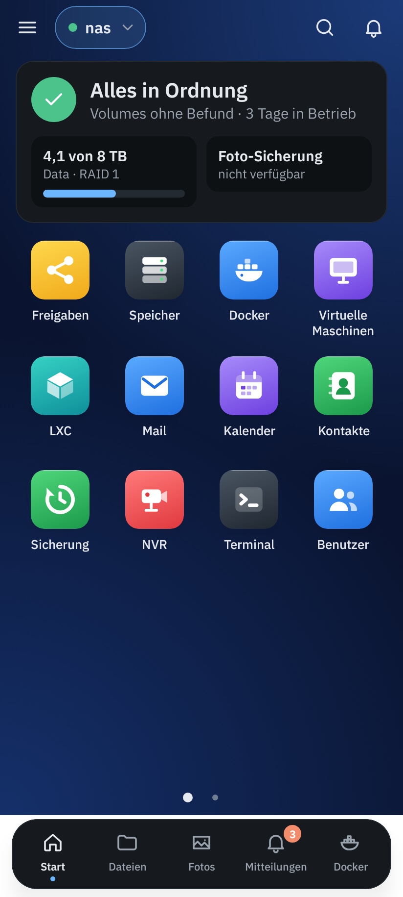
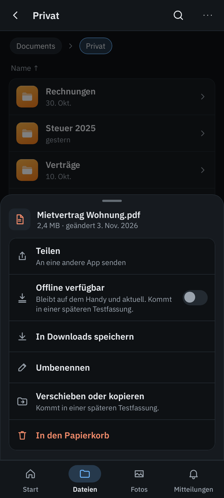

# TitanOS für Android

Die native Android-App zu [TitanOS](https://github.com/ra5on/TitanOS), dem NAS-Betriebssystem, das vom USB-Stick bootet und im RAM läuft. Sie bringt dein NAS aufs Handy, im selben Stil wie die Weboberfläche:

- Dateien
- Zustand des NAS
- Schritt für Schritt alles, was TitanOS im Browser kann: Foto-Sicherung im Hintergrund, Mail, Kalender und Kontakte in den Apps des Handys, Mitteilungen ohne Google, die ganze Systemsteuerung.

> **Status: Testfassung 0.02.** Frühes Grundgerüst zum Ausprobieren, noch keine fertige App. Was noch fehlt, zeigt sie mit „kommt in einer späteren Testfassung“.

<p>




</p>

## Was die Testfassung kann

- **Koppeln mit dem NAS.** Passwort und 2FA kommen dabei nie aufs Handy. Die App bekommt einen eigenen Schlüssel und hält das Zertifikat des NAS fest.
- **Start:** Zustand der Volumes, Laufzeit, Belegung und die Programme, die dein Konto sehen darf.
- **Dateien:**
  - Freigaben und Ordner durchsuchen
  - Teilen, In Downloads speichern, Umbenennen, In den Papierkorb
  - Hochladen über „+“
  - **Übertragungen im Hintergrund:** laufen weiter, wenn die App zu ist, und machen nach einem Abbruch beim Stand des NAS weiter; die Liste nennt den Grund, wenn etwas wartet, mit „Erneut versuchen“
  - **Offline verfügbar:** Dateien und ganze Ordner auf dem Handy behalten, abgeglichen alle 6 Stunden (ab Werk nur im WLAN, höchstens 5 GB), lesend zu öffnen auch ohne NAS
  - **Teilen-Menü:** „Teilen → Auf TitanOS speichern“ aus jeder App
- **Foto-Sicherung** (braucht **TitanOS 1.17**):
  - in eine frei wählbare Freigabe und einen Ordner, ab Werk mit Unterordnern je Jahr und Monat
  - Ordner am Handy wählbar, ab Werk die Kamera
  - wann, je Fotos und Videos: sofort, sofort im WLAN, im WLAN und beim Laden oder nur von Hand; mobile Daten auf Wunsch, im Ausland nie
  - Doppelte erkennt das NAS am Inhalt (SHA-256), auch nach Umbenennen
  - die App sagt immer, warum etwas wartet („wartet aufs Laden“, „das NAS ist nicht erreichbar“)
  - „Speicher freigeben“ löscht nur, was das NAS gerade per Prüfsumme bestätigt, älter als 30 Tage, nur auf Knopfdruck; Android fragt noch einmal, alles liegt 30 Tage im Papierkorb des Handys
- Hell und dunkel nach der Einstellung des Handys, Deutsch und Englisch.

## Installieren und koppeln

Nötig sind Android 13 oder neuer und ein NAS mit **TitanOS 1.16** oder neuer (Kopplung, Dateien). Für die Foto-Sicherung braucht es **TitanOS 1.17**.

1. **APK laden** von der Seite [Releases](https://github.com/ra5on/TitanOS-Android/releases). Testfassungen gibt es vorerst direkt vom Projekt.
2. **Installieren:** Die APK auf dem Handy öffnen. Beim ersten Mal fragt Android, ob der Browser bzw. die Dateien-App „unbekannte Apps installieren“ darf. Erlauben, dann „Installieren“.
3. **Code anzeigen:** Im Browser in TitanOS **Mein Konto › Geräte › Android-Apps › „Android-App koppeln“** öffnen.
4. **In der App koppeln**, auf einem von drei Wegen:
   - **QR-Code scannen**, wenn TitanOS auf einem anderen Gerät offen ist.
   - **„Auf diesem Handy öffnen“**, wenn TitanOS im Browser desselben Handys offen ist.
   - **„Adresse von Hand eingeben“:** Die App zeigt den Fingerabdruck des Zertifikats in Vierergruppen. Im Browser unter „Ohne QR-Code“ steht derselbe Wert und ein Kopplungscode zum Abtippen.
5. **Bestätigen:** Der Browser fragt „<Name> möchte sich anmelden“. Mit deinem Kontopasswort bestätigen, dann macht die App von selbst weiter.

Zuhause verbindet sich die App direkt über das Heimnetz, unterwegs über Tailscale. Unter **Mein Konto › Geräte** siehst du jede gekoppelte App. Dort beendest du sie mit „Beenden“, dann ist sie sofort abgemeldet.

<p>


</p>

## Sicherheit

- **Die App ist eine Sitzung wie der Browser, kein API-Token.** Es gelten genau die Rechte deines Kontos.
- **Eigener Schlüssel je Handy:** ECDSA P-256, erzeugt im Android-Schlüsselspeicher, nicht auslesbar. Das NAS kennt nur den öffentlichen Teil. Mit dem Schlüssel unterschreibt die App eine Herausforderung, wenn sie eine neue Sitzung braucht, etwa nach einem Neustart des NAS.
- **Festgehaltenes Zertifikat (SPKI-Pinning):** Zeigt das NAS plötzlich ein anderes Zertifikat, fragt die App, statt still weiterzumachen. Namen mit öffentlichem Zertifikat (Let's Encrypt, `*.ts.net`) prüft sie zusätzlich ganz normal.
- **Ende:** Ein neues Kontopasswort, eine geänderte 2FA, „Beenden“ oder das Löschen des Kontos beenden die App.
- **Keine Google-Dienste:** kein Google Play Services, kein Firebase, kein ML Kit.

Einzelheiten zur Schnittstelle stehen in [`docs/ANDROID-APP.md`](https://github.com/ra5on/TitanOS/blob/main/docs/ANDROID-APP.md) im Repo TitanOS.

## Was als Nächstes kommt

In dieser Reihenfolge, jeweils als Testfassung:

1. ~~Dateien fertig~~ und ~~Foto-Sicherung~~ – in 0.02.
2. **Kontakte und Kalender** als Konto in den Apps des Handys, Abgleich in beide Richtungen; Mail.
3. **Zustand und Verwaltung:** Speicher, Docker, VMs, Systemcontainer, NVR, Sicherungen, Protokolle.
4. **Die ganze Systemsteuerung.** Sensible Einstellungen bestätigst du per Fingerabdruck.
5. **Agent-App**, Widgets, Mitteilungen ohne Google, Selbst-Update.

Danach folgt Version 1.00 mit allem.

## Bauen

Nötig sind JDK 21 und das Android-SDK mit `platforms;android-37.0` und `build-tools;37.0.0`.

```bash
export JAVA_HOME=/pfad/zu/jdk-21
export ANDROID_HOME=/pfad/zu/android-sdk
./gradlew assembleDebug testDebugUnitTest lint
```

Die Debug-APK liegt danach unter `app-titanos/build/outputs/apk/debug/`.

- **Bildtests:** `./gradlew recordRoborazziDebug` schreibt alle Bildschirme in 412 dp Breite, hell und dunkel, nach `app-titanos/build/outputs/roborazzi/`.
- **Release:** Ein Tag `vX.Y.0` startet `.github/workflows/release.yml`.
  - **Version:** angezeigt X.YY, `versionCode` X·100+Y. Der Workflow prüft, dass `build.gradle.kts` dazu passt.
  - **Signieren:** nur im Job „publish“ der Umgebung `release`. Die Umgebung lässt nur Tags `v*` zu und wartet auf die Freigabe des Inhabers. Der Schlüssel liegt dort als Secret.
  - **Prüfung vor dem Veröffentlichen:** Die APK muss das Zertifikat mit dem SHA-256 `636b5723…725c` tragen, sonst bricht der Lauf ab. Danach kommen APK und `SHA256SUMS` als Release auf GitHub, vor 1.00 als Vorab-Release.
  - **Versionshinweise** stehen in `docs/releases/vX.Y.0.md`.
  - **Lokal** signiert man über die Umgebungsvariablen `TITANOS_KEYSTORE` (Pfad zum Keystore) und `TITANOS_KEYSTORE_PASSWORD`, Alias `titanos-release`. Ohne sie bleibt `assembleRelease` unsigniert.
- **Stil:** Farben, Maße, Programmsymbole und die Schrift (IBM Plex) erzeugt `web/scripts/android-theme.mjs` im Repo TitanOS aus der Weboberfläche. Das Ergebnis unter `core-ui/…/ui/generated/` und `core-ui/src/main/res/font/` ist eingecheckt; geändert wird im Repo TitanOS, nicht hier.
  ```bash
  node web/scripts/android-theme.mjs ../TitanOS-Android
  ```
- **Kein abgeschnittener Text:** Eine eigene Lint-Regel verbietet `TextOverflow.Ellipsis` und `maxLines` bei Text.

## Aufbau

| Modul | Inhalt |
|---|---|
| `:core-model` | Datentypen der API |
| `:core-net` | OkHttp, Zertifikatsprüfung mit SPKI-Pinning, Geräteschlüssel im Keystore, Kopplung, Sitzung |
| `:core-ui` | TitanOS-Theme hell/dunkel, Bausteine, Symbole, Schrift |
| `:feature-pairing` | Willkommen, QR-Code, Adresse von Hand, Koppeln bestätigen, Berechtigungen |
| `:feature-home` | Start mit Zustandskarte und Programmen |
| `:feature-files` | Freigaben, Ordner, Datei-Aktionen, Übertragungen |
| `:app-titanos` | die App „TitanOS“ (`io.github.ra5on.titanos`) |
| `:app-agent` | die App „Agent“ (`io.github.ra5on.titanos.agent`), noch leer |
| `:lint-rules` | Lint-Regel gegen abgeschnittenen Text |

## Lizenz

Die App ist **Fair Source** unter der [Functional Source License 1.1 mit Apache-2.0-Zukunftslizenz (FSL-1.1-ALv2)](LICENSE.md), wie TitanOS. Nutzen, Ändern und Weitergeben ist erlaubt, nur kein konkurrierendes kommerzielles Angebot. Zwei Jahre nach Erscheinen steht jede Version unter der Apache License 2.0; bis dahin ist sie nicht „Open Source“.

Fremde Bestandteile behalten ihre Lizenz, siehe [THIRD_PARTY_LICENSES](THIRD_PARTY_LICENSES). Beiträge nur mit dem [CLA](CLA.md), siehe [CONTRIBUTING.md](CONTRIBUTING.md).
